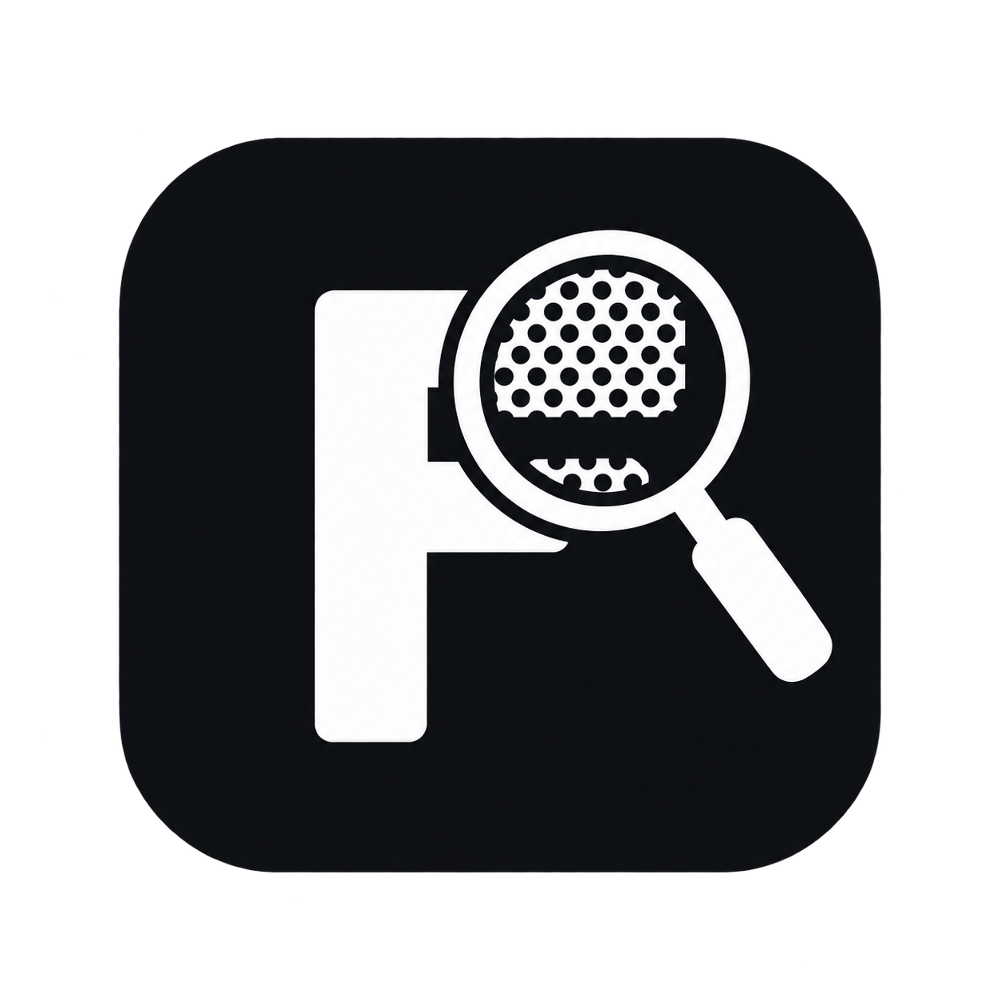

# FieldWas for Jira

{ .fieldwas-product-logo }

Find work items that held a custom-field value at any time in a selected period.

FieldWas adds historical custom-field search to Jira Cloud. Use it when the current value is not enough—for example, to find work that was once marked as `Blocked`, assigned to a particular team, or planned for a release.

```jql
issue in fieldWas("Customer tier", "Gold", "-30d", "now")
```

[Get started](getting-started.md){ .md-button .md-button--primary }
[JQL reference](jql.md){ .md-button }

## Key features

- Find work items that held a value during a time period, even when the value has since changed.
- Search every project configured by your Jira administrator, or optionally narrow the search to selected projects.
- Works with 19 native Jira custom-field types, including select lists, text, dates, users, groups, versions, labels, and projects.
- Reads a reusable history index instead of downloading every work item's changelog for each search.
- Keeps results current when indexed work items change.
- Combine the result with the rest of your normal JQL.

## Example

```jql
issue in fieldWas("Customer tier", "Gold", "-30d", "now")
AND statusCategory != Done
```

## Before users search

Your Jira administrator chooses which custom fields, projects, and amount of history FieldWas indexes. A search can only use this configured coverage. See [Administrator setup](administration.md).

There is no 1,000-result limit. Searches with up to 1,000 matches return immediately. The first run of a larger search prepares a Jira-native projection in the background and asks the user to run the search again after a short wait.
